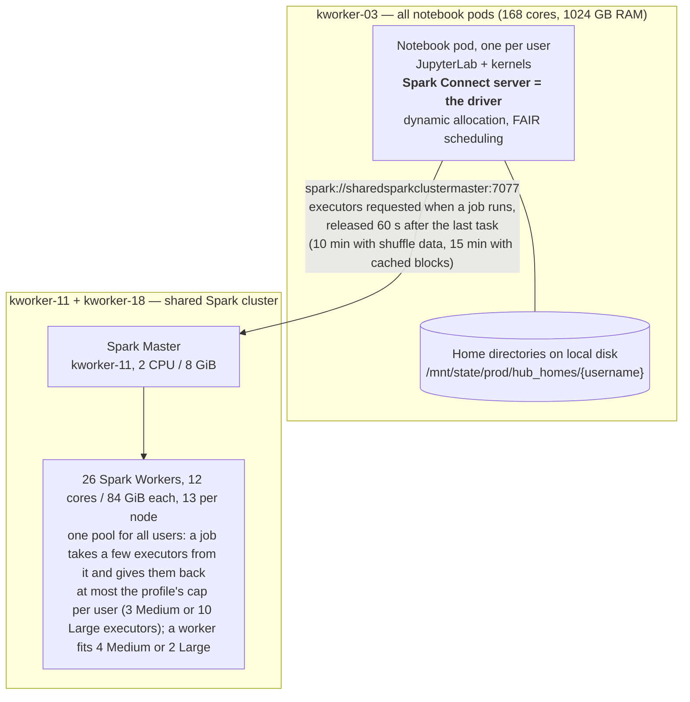

# KBERDL CPU/RAM Capacity Analysis

---

## 1. Current State

### 1.1 Cluster Node Inventory

| Node | Cores | RAM | Disk | Current Assignment |
|------|------:|----:|-----:|-------------------|
| kworker-01 | 168 | 1024 GB | 100 TB | Dev/Staging Services |
| kworker-02 | 168 | 1024 GB | 100 TB | Prod Services |
| kworker-03 | 168 | 1024 GB | 100 TB | All user notebook pods |
| kworker-05 – 10 | 168 each | 1024 GB each | 100 TB each | Per-user Spark clusters (retiring: no new cluster since 2026-10-11; nodes move to the shared cluster in pairs) |
| kworker-11 | 168 | 1024 GB | 100 TB | Shared Spark cluster (master + 13 workers) |
| kworker-12 | 168 | 1024 GB | 100 TB | Trino cluster (coordinator + 4 workers) |
| kworker-13 | 168 | 1024 GB | 100 TB | Other workloads |
| kworker-14 – 17 | 168 each | 1024 GB each | 100 TB each | Per-user Spark clusters (retiring, as above) |
| kworker-18 | 168 | 1024 GB | 100 TB | Shared Spark cluster (13 workers) |
| kworker-19 | 168 | 1024 GB | 100 TB | Other workloads |
| kworker-20 | 168 | 1024 GB | 100 TB | Other workloads |

**Dedicated Spark pool: 10 nodes** (kworker-05–10, kworker-14–17) — **1,680 cores, 10,240 GB RAM total**, being retired: four clusters started before 2026-10-11 remain, and the nodes join the shared cluster a pair at a time once they are empty (design doc, section 4.2). **Idle: kworker-13, 19, 20** (and 01, 04 apart from dev/stage services), the first candidates for growing the shared cluster.

### 1.2 User Workload Components

A user session has **two Spark parts on two node groups**, both set up by [BERDL_JupyterHub](https://github.com/KBaseDataLakehouse/BERDL_JupyterHub) at spawn: the notebook pod, which also hosts the Spark driver, and executors taken from the shared cluster on demand.

- The **driver** is the Spark Connect server inside the notebook pod; kernels, the data API and remote clients (through the Spark Connect proxy) talk to it over gRPC. Its memory is part of the pod's limit.
- **Executors** are launched on the shared workers when the user's job starts and released a minute after it ends (10 minutes if they hold shuffle data, 15 if they hold cached blocks). An idle user holds nothing on the cluster.
- Other users of the same cluster: the data API's standalone applications (section 3.4) and the event processor.
- **Trino** (section 5) runs on its own node and answers SQL for notebooks and for the data API, which defaults to it.

### 1.3 Profiles

A user picks **Medium** or **Large** at spawn. The profile sets the notebook pod's limits, the driver's size and the executor shape and cap on the shared cluster; the executor shapes match what a dedicated cluster of that profile used to give, so no task that fit before runs out of memory now.

| | Medium (default) | Large |
|---|---|---|
| Notebook pod CPU (user's pod on kworker-03) | 1 core guaranteed, 2 cores limit | 1 core guaranteed, 8 cores limit |
| Notebook pod memory (user's pod) | 6 GB guaranteed, 48 GB limit | 6 GB guaranteed, 48 GB limit |
| Driver (the Spark Connect server, inside the user's pod) | 1 core / 4 GiB heap | 2 cores / 8 GiB heap |
| Executor (on the shared Spark cluster, kworker-11 + 18) | 3 cores / 18 GiB heap | 6 cores / 36 GiB heap |
| Cap (most executors one user holds at once on the shared cluster) | 3 (9 cores / 54 GiB) | 10 (60 cores / 360 GiB) |
| Share of the pool at full burst (Medium-sized units) | 3 of 104 | 20 of 104 |

> The 48 GB pod limit and the per-profile CPU limits date from 2026-10-05 (BERDL_JupyterHub #108); a pod started before then keeps 24 GB until its next restart. In-pod compute that outgrows the limit is OOM-killed by the cgroup; Spark executors do not count against it, they run on the shared workers. The cap is a ceiling, not a reservation: with dynamic allocation an idle user of either profile holds no executors.

---

## 2. Notebook Pod Capacity (kworker-03)

### 2.1 Available Resources

| Resource | Total | System/OS Overhead (~5%) | Available for Workloads |
|----------|------:|-------------------------:|------------------------:|
| CPU | 168 cores | ~8 cores | **~160 cores** |
| RAM | 1024 GB | ~50 GB | **~974 GB** |

### 2.2 Maximum Concurrent Users

**Per-user notebook pod:** 1 core (guarantee), 2 cores Medium / 8 cores Large (limit), 48 GB RAM (limit), 6 GB RAM (guarantee)

> [!NOTE]
> Spark executors run on the shared cluster (kworker-11 and kworker-18), **not** on kworker-03. The arithmetic below only considers the notebook pods.

| Bottleneck | Available | Per User | Max Users |
|-----------|----------:|---------:|----------:|
| CPU (by guarantee) | 160 cores | 1 core | **160 users** |
| RAM (by guarantee) | 974 GB | 6 GB | **162 users** |
| RAM (by limit) | 974 GB | 48 GB | 20 users |

> **Result: kworker-03 can schedule up to ~160 concurrent notebook pods** (CPU guarantee is the binding constraint).
>
> RAM overcommit ratio is 8× (48 GB limit / 6 GB guarantee). At 100 users, total guaranteed RAM = 600 GB (62% of 974 GB). Total limit = 4,800 GB — typical JupyterLab + Spark Connect driver pods rarely approach their memory limit, so this overcommit is acceptable; the cases that do reach the limit are in-pod compute from agent sessions, which the cgroup kills, not Spark.

---

## 3. Shared Spark Cluster (kworker-11 + kworker-18)

The shared Spark standalone cluster carries every notebook user's Spark since 2026-10-11, plus the data API's standalone applications and the event processor. Design and operations: [shared_spark_compute_design.md](shared_spark_compute_design.md). Re-cut to the shape below on 2026-10-03.

### 3.1 Cluster Configuration

| Component | Cores | Memory | Replicas | Node |
|-----------|------:|-------:|---------:|------|
| Spark Master | 2 | 8 GiB (4 GiB daemon heap) | 1 | kworker-11 |
| Spark Workers | 12 each | 84 GiB each (`SPARK_WORKER_MEMORY=72g`) | 26 (13 per node) | kworker-11 + kworker-18 |
| **Total** | **314** | **2,192 GiB** | | **312 worker cores, 1,872 GiB of executor memory** |

> The master keeps `FILESYSTEM` recovery on a host path, so a restart re-adopts running applications, and `spark.deploy.defaultCores=8` bounds a session that sets no core limit. Workers are placed by node affinity on the two tainted nodes; 13 per node uses 156 of 168 cores and leaves memory for the node's own daemons.
>
> 12 cores / 72 GiB per worker is a multiple of both executor shapes: a worker holds 4 Medium executors (3 cores / 18 GiB), 2 Large (6 cores / 36 GiB) or 2 Medium + 1 Large, with nothing stranded. Local disk I/O (shuffle, spill, cached blocks) is encrypted per application (`spark.io.encryption.enabled`, since 2026-10-11) because every application's executors share the worker's uid.

### 3.2 Resource Utilization (requests on the two nodes)

| Resource | Allocatable (2 nodes) | Requested | Utilization |
|----------|----------------------:|----------:|------------:|
| CPU | 336 cores | 314 cores | **93.5%** |
| RAM | 2,266 GiB | 2,192 GiB | **96.7%** |

### 3.3 Capacity Model (what the pool serves)

| | Medium units (3 cores / 18 GiB) | Large units (6 cores / 36 GiB) |
|---|---:|---:|
| slots on two nodes | 104 | 52 |
| one user at full burst | 3 (Medium cap) | 10 (Large cap, 20 Medium units) |
| each added node (13 workers) | +52 | +26 |

Demand is measured, not reserved. Over the first two days with every user on the pool (19 notebooks at once at most): peak 84 of 312 cores in use, p95 of 12 executors held at once across all users, the worst user short of an executor for 18 minutes in total, first executor after idle in 2.7 s at the median and 2.8 s at the 95th percentile, 3,497 executor endings all normal. Growing the pool is one Deployment edit per node (design doc, section 4); the idle nodes and, once empty, the ten retiring pool nodes are the candidates.

### 3.4 Data API Executor Configuration

The [datalake-mcp-server](https://github.com/KBaseDataLakehouse/datalake-mcp-server) (data API) answers through Trino by default since 2026-10-01. Its Spark path uses the caller's own notebook Connect server when one is running, and otherwise a standalone application on the shared cluster:

| Setting | Value | Description |
|---------|-------|-------------|
| `SPARK_WORKER_CORES` | 2 | Cores per executor |
| `SPARK_WORKER_COUNT` | 2 | Executors per job |
| `SPARK_WORKER_MEMORY` | 16 GiB | Memory per executor |
| `STANDALONE_SPARK_POOL_SIZE` | 8 | Concurrent standalone sessions per replica |
| **Per-job total** | **4 cores, 32 GiB** | 2 executors × (2c, 16G) |

**Executor packing per worker (12c, 72G):** 6 by CPU, 4 by memory → **4 executors per worker**, 26 workers × 4 = **104 executor slots**, or **52 concurrent standalone jobs** against 8 replicas × pool size 8 = 64 sessions. In practice the standalone path serves a handful of calls a day; the notebook applications set the pool's load.

---

## 4. Combined Capacity Summary

**How many users the system holds**

| Question | Answer | Why |
|---|---:|---|
| Concurrent notebook users (servers running) | **~160**, either profile | kworker-03's 1-core guarantee per pod (section 2); the shared cluster adds no per-user limit, an idle user holds no executors there |
| Users running Spark jobs at the same instant before anyone waits | **34 Medium** or **5 Large** at full cap, or any mix of 104 Medium-sized units | the pool is 312 cores: 104 executors of 3 cores or 52 of 6 (section 3.3) |
| What happens past that | jobs **wait** for executors, they do not fail | the master grants executors as others release them (60 s after a job's last task); a waiting job's cell simply takes longer |
| Measured so far at every-user scale | p95 12 executors held at once, peak 18, with 19 notebooks | under a sixth of the pool's slots (section 3.3) |
| Trino concurrent queries | 40–96 by load; 50 global, 10 per user by resource groups | kworker-12 (section 5) |

So **160 users of the Large profile can all be connected**: each has its driver in its own pod and an application registered on the master holding nothing while idle. If all 160 ran a job at the same instant, the master would grant the 52 Large executors to the first requests, one per user, and the other users' jobs would wait their turn; with executors released a minute after each job's last task, the pool turns over at the pace of the jobs. In practice the measured simultaneous demand has been a dozen executors, so nobody has waited more than a few minutes in total over two days.

Two limits of this model to keep in mind: the standalone master grants executors first come, first served, with no fairness between users, so under sustained contention the user who asked first keeps being served first; and a user with no executors waits with no timeout in a notebook (the data API's Spark queries time out after 15 minutes). The signal that the pool is too small is minutes in which a server wants more executors than it holds (the `spark_da_usage` records; the status page's shared-cluster table). Growing it is one Deployment edit per node, +52 Medium-sized units each (design doc, section 4); the five idle nodes and, once empty, the ten retiring pool nodes are the candidates. Before the change the same 160 users needed ten nodes of reserved per-user clusters (section 6).

---

## 5. Trino Query Engine (kworker-12)

A shared Trino cluster on **kworker-12** provides interactive SQL query capabilities for all users. Like the shared Spark cluster, Trino is one cluster for everyone, with fair scheduling via resource groups.

### 5.1 Cluster Configuration

| Component | Cores | Memory | Heap (-Xmx) | Replicas | Purpose |
|-----------|------:|-------:|------------:|---------:|---------|
| Coordinator | 4 | 32 GiB | 24G | 1 | Query planning, scheduling, Web UI |
| Workers | 40 each | 240 GiB each | 192G | 4 | Query execution |
| **Total** | **164** | **992 GiB** | | **5 pods** | |

> The coordinator does not execute queries (`node-scheduler.include-coordinator=false`). All query execution runs on the 4 dedicated workers.

### 5.2 Resource Utilization

| Resource | Total (kworker-12) | Used | Utilization |
|----------|-------------------:|-----:|------------:|
| CPU | 168 cores | 164 cores | **97.6%** |
| RAM | 1024 GB | 992 GiB | **96.9%** |

### 5.3 Memory Limits

| Setting | Value | Description |
|---------|-------|-------------|
| `query.max-memory` | 100 GB | Max memory a single query can use across all workers |

Trino automatically manages per-node memory allocation. The query memory pool per worker is ~80% of heap = ~154 GB.

### 5.4 Concurrency (Resource Groups)

| Setting | Value | Description |
|---------|-------|-------------|
| Global concurrent queries | 50 | Max queries running across all users |
| Global queued | 500 | Max queries waiting in queue |
| Per-user concurrent queries | 10 | Max running queries per user |
| Per-user queued | 50 | Max queued queries per user |
| Per-user soft memory limit | 20% | One user can use at most 20% of cluster memory |
| Scheduling policy | weighted_fair | Active users share capacity equally |

**Concurrent query capacity estimate:**
- At 40 GB per query max: 960 GB pool / 40 GB = 24 large queries concurrently
- At 10 GB per query avg: 960 GB pool / 10 GB = 96 typical queries concurrently
- CPU-bound: 160 worker cores / 4 cores per query avg = 40 queries concurrently

> **Result: kworker-12 can handle ~40–96 concurrent queries** depending on query complexity. The resource group limits (50 global, 10 per-user) keep this within safe bounds.

---

## 6. Per-User Spark Cluster Capacity (kworker-05–10, 14–17) — rollback path only

> This section sizes the dedicated-cluster model that was the default until 2026-10-11. It applies again only if the hub's shared-mode gate is rolled back (narrow `DYNAMIC_ALLOCATION_ROLES` or unset `SHARED_SPARK_MASTER_URL`; the next spawn then builds a dedicated cluster). Four clusters started before that date are still running and leave as their users restart.

Per-user Spark clusters (managed by [spark_cluster_manager](https://github.com/KBaseDataLakehouse/spark_cluster_manager)) ran on **10 dedicated nodes** (kworker-05 through kworker-10, kworker-14 through kworker-17). Each node has 168 cores and 1024 GB RAM.

**Total Spark pool: 1,680 cores, 10,240 GB RAM**

### 6.1 Medium Spark Cluster

| Component | Cores | Memory |
|-----------|------:|-------:|
| Spark Master (×1) | 1 | 2 GiB |
| Spark Workers (×3) | 3 each (9 total) | 20 GiB each (60 GiB total) |
| **Per-user total** | **10 cores** | **62 GiB** |

| Bottleneck | Total Pool | Per User | Max Users |
|-----------|----------:|---------:|----------:|
| CPU | 1,680 cores | 10 cores | **168 users** |
| RAM | 10,240 GB | 62 GB | **165 users** |

> 3 cores/worker is the sweet spot for Spark executors (balances parallelism vs GC pressure). 20 GiB/worker provides 6.7 GB/core. **10 Spark nodes could serve up to ~165 concurrent Medium clusters** (RAM is the bottleneck); at 160 users: 9,920 GiB (96.9% RAM), 1,600 cores (95.2% CPU), reserved whether or not anything ran.

### 6.2 Large Spark Cluster

| Component | Cores | Memory |
|-----------|------:|-------:|
| Spark Master (×1) | 2 | 8 GiB |
| Spark Workers (×10) | 6 each (60 total) | 40 GiB each (400 GiB total) |
| **Per-user total** | **62 cores** | **408 GiB** |

| Bottleneck | Total Pool | Per User | Max Users |
|-----------|----------:|---------:|----------:|
| CPU | 1,680 cores | 62 cores | **27 users** |
| RAM | 10,240 GB | 408 GB | **25 users** |

> Large is 4× the memory and ~4× the cores of Medium. **10 Spark nodes could serve up to ~25 concurrent Large clusters** (RAM is the bottleneck). On the shared cluster the same executor shapes are taken on demand, so the Large cap costs nothing while the user is idle.
