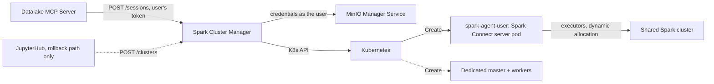

# Spark Cluster Manager

> The REST API behind BERDL's Spark provisioning: session pods for users without a notebook (the session gateway and its reaper), dedicated per-user Spark clusters as the rollback path, and the shared cluster's usage records.

| | |
|---|---|
| **Docker Image** | `ghcr.io/kbasedatalakehouse/spark_cluster_manager:main` |
| **GitHub Repo** | [spark_cluster_manager](https://github.com/KBaseDataLakehouse/spark_cluster_manager) |
| **Python** | 3.12 |
| **Framework** | FastAPI 0.135 / Uvicorn |
| **Package Manager** | uv |

## Overview

A REST API service with two products on Kubernetes, configured from one hot-reloaded policy file (`cluster-manager-policy.yaml`):

1. **Session pods** (since 2026-10-24): the `/sessions` gateway creates one Spark Connect server pod per user on the shared Spark cluster's nodes, on demand and with the user's own credentials, for callers that have no notebook pod (today the [Datalake MCP Server](./datalake-mcp-service.md) for AI assistants). A **session reaper** removes idle, aged or unhealthy sessions. See [Spark Session Pods and the Session Gateway](./spark-session-gateway.md).
2. **Dedicated clusters**: a Spark master and workers per user, the way every notebook got its Spark until 2026-10-11. Since then notebooks run on the **shared cluster** ([shared_spark_compute_design.md](../infrastructure/shared_spark_compute_design.md)) and the dedicated path is kept as the rollback; its orphan reaper removes clusters whose notebook is gone.

It also runs the **usage reporter**, which records every application on the shared master once a minute.

> **Note**: This architecture separates the *management* of the pods (done by this API) from the *container image* running them (the `kube_spark_manager_image` repository, in its `master`, `worker` and `connect` modes).

## Key Features

- **Session gateway**: `POST /sessions` is idempotent, waits for the pod to be ready and answers with its address; 429 with `Retry-After` when every slot is taken, 503 while a pod is still starting, 502 when the governance service cannot provide credentials.
- **Session reaper**: removes a session after 10 idle minutes with no running job, after 8 hours (24 regardless), when never Ready, or when its Secret is leaked; `enforce`, `dry-run` or `off` without a restart.
- **Dedicated clusters (rollback path)**: creates and tears down a Spark master and worker pods per user; the orphan reaper cleans up clusters whose owner is gone.
- **One policy file**: shape, caps (global, per tenant, per user), placement nodes, gateway waits and reaper modes in `cluster-manager-policy.yaml`, hot-reloaded; the environment carries only wiring (namespace, service URLs, Redis, image, tolerations).
- **KBase Auth**: every route is secured by KBase tokens; the session pods never see a token, the caller's token is used once to fetch their credentials.
- **Usage records**: JSON lines for the shared cluster's applications, the gateway's outcomes and the reapers' verdicts, read by the operations sweeps.

## API Endpoints

| Method | Endpoint | Description |
|--------|----------|-------------|
| GET | `/health` | Check the health status of the service |
| POST | `/sessions` | Ensure the caller's session pod (create if absent, wait until ready) and return its Spark Connect address |
| GET | `/sessions/me` | State of the caller's session: `absent`, `starting`, `ready` or `unhealthy`, node, age, idle time, application |
| DELETE | `/sessions/me` | Delete the caller's session pod |
| POST | `/sessions/me/activity` | Reset the caller's session idle clock |
| GET | `/sessions` | List every session (administrators) |
| DELETE | `/sessions/{user}` | Force-delete a user's session (administrators) |
| POST | `/clusters` | Creates a dedicated Spark cluster for the authenticated user (rollback path) |
| GET | `/clusters` | Get the status/connection details of the user's dedicated cluster |
| DELETE | `/clusters` | Deletes the dedicated cluster belonging to the authenticated user |

## Architecture

