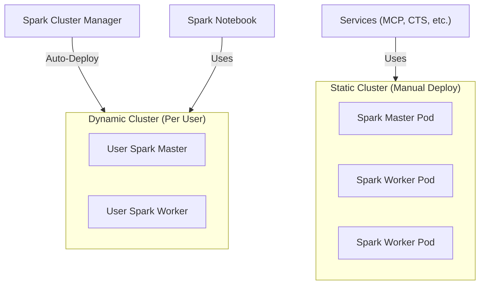

# Spark Cluster (Static & Dynamic)

> The Docker image used for all Spark clusters, supporting both master and worker modes.

| | |
|---|---|
| **Docker Image** | `ghcr.io/kbasedatalakehouse/kube_spark_manager_image:main` |
| **GitHub Repo** | [kube_spark_manager_image](https://github.com/KBaseDataLakehouse/kube_spark_manager_image) |
| **Base Image** | [spark_notebook](./spark_notebook.md) |

## Overview

This image is used to run Spark in Kubernetes. It supports three modes, selected with the `SPARK_MODE` environment variable:

1.  **Shared (static) cluster**: the master and the 26 workers every notebook user's Spark runs on since 2026-10-11 ([shared_spark_compute_design.md](../infrastructure/shared_spark_compute_design.md)); also used by the Datalake MCP Server's standalone applications.
2.  **Dedicated (dynamic) cluster**: a master and workers per user, deployed by the [Spark Cluster Manager](./spark-cluster-manager.md); the rollback path since the shared cluster took over.
3.  **Connect** (`SPARK_MODE=connect`, since 2026-10-24): one user's Spark Connect server in the foreground, the **session pod** the Spark Cluster Manager's gateway creates for a user who has no notebook ([spark-session-gateway.md](./spark-session-gateway.md)). It renders the same Spark configuration a notebook gets, from the environment and a mounted credentials Secret.

## Key Features

- **Three modes**: runs as `master`, `worker` or `connect` (a Spark Connect server) based on the `SPARK_MODE` env var.
- **Inherited Environment**: Built on `spark_notebook` Base, inheriting all Python dependencies and Spark configurations.
- **Redis Caching Integration**: Includes built-in support for Redis caching to accelerate Spark DataFrame operations.
- **K8s Native**: Designed for Kubernetes deployment with proper entrypoint scripts.

## Architecture

## Configuration

The container runs in one of two modes based on `SPARK_MODE`:

| Mode | Description | Required Env Vars |
|------|-------------|-------------------|
| `master` | Starts Spark Master daemon | None (uses Spark defaults) |
| `worker` | Starts Spark Worker daemon | `SPARK_MASTER_URL` (e.g., `spark://master:7077`) |

## Static Cluster Deployment

The static cluster is manually deployed to the `prod` namespace:
- **Service**: `sharedsparkclustermaster`
- **Port 7077**: Spark Master URL
- **Port 8090**: Web UI

> **Role**: Serves as a **fallback** for the MCP Server when no user-specific dynamic cluster is available.

## Dynamic Cluster Deployment

Dynamic clusters are created automatically by the [Spark Cluster Manager](./spark-cluster-manager.md):
- Triggered when a user logs into JupyterHub
- Creates dedicated master + worker pods for the user
- Provides resource isolation and guaranteed compute

## Relationship to Notebooks

Notebooks connect to either:
- Their **dynamic cluster** (primary) for isolated, guaranteed resources
- The **static cluster** (fallback) when accessed directly without JupyterHub context
