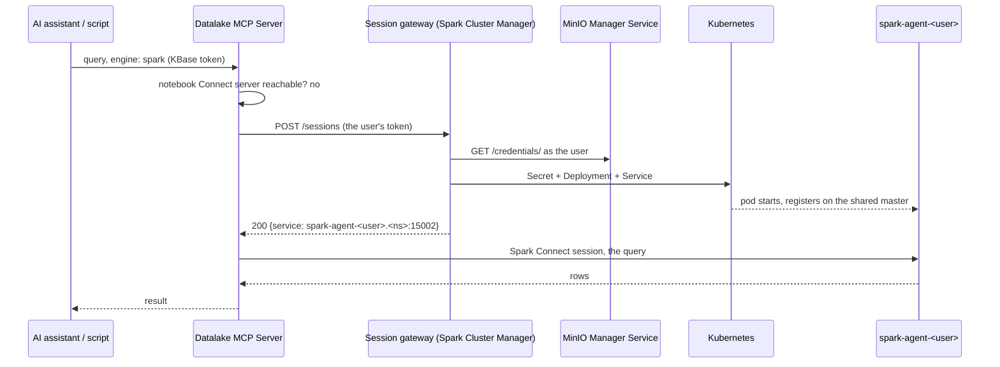

# Spark Session Pods and the Session Gateway

> Spark for callers that have no notebook: one Spark Connect server pod per user on the shared cluster, created on demand by the Spark Cluster Manager and removed when idle.

| | |
|---|---|
| **Gateway** | the `/sessions` routes of the [Spark Cluster Manager](./spark-cluster-manager.md) (`spark-cluster-manager.<env>:8000`) |
| **Pod image** | [kube_spark_manager_image](https://github.com/KBaseDataLakehouse/kube_spark_manager_image) in `SPARK_MODE=connect`, built from the notebook image |
| **First client** | the [Datalake MCP Server](./datalake-mcp-service.md), for AI assistants and scripts |
| **Since** | 2026-10-24 (gateway and reaper in prod), 2026-10-26 (the data API uses it) |

## Overview

A notebook user's Spark runs as a Spark Connect server inside their notebook pod, with executors from the shared cluster ([shared_spark_compute_design.md](../infrastructure/shared_spark_compute_design.md)). AI assistants and scripts that reach the lake through the data API have no notebook pod, so until October 2026 their Spark queries ran as short standalone applications: a fresh Spark application per request, about 12 seconds each, with no session state between requests.

A **session pod** gives such a caller the same thing a notebook user has: a long-lived Spark Connect server running **as that user**, with the user's own storage keys and catalog credentials, registered on the shared Spark master with dynamic allocation. The first query of a conversation waits for the pod to start (about 15 seconds); later queries take milliseconds to a few seconds, and the pod is removed after ten minutes without activity.

Session pods are for **agents and services only**. Remote PySpark through the [Spark Connect Proxy](./spark_connect_proxy.md) still needs a running notebook, and a running notebook always wins: when a user's notebook is up, the data API uses it and any session pod of theirs goes idle and is reaped.

## How a request gets a session pod

1. The data API tries the user's notebook first (`sc://jupyter-<user>...:15002`). If it answers, nothing below happens.
2. Otherwise it calls `POST /sessions` on the cluster manager with the request's own KBase token. The gateway creates the pod on first contact and waits until it is ready, or reuses the existing one; every call refreshes the session's activity stamp, so the reaper's idle clock follows real use.
3. The data API probes the returned address, connects, and caches the Spark Connect session per user and address. It remembers the gateway's answer for 30 seconds, so a burst of requests makes one gateway call.
4. If the gateway refuses or is down, the request falls back to a standalone application on the shared cluster, as before. Refusals are: every session slot taken (429 with `Retry-After`), the pod still starting past the gateway's wait (503 with `Retry-After`), credentials unavailable from the governance service (502), or the gateway unreachable. Nothing fails for the caller; the request is only slower.

## The objects

For user `alice`, in the hub's namespace (`jupyterhub-prod`), labelled `app=spark, component=session, user=alice`:

| Object | Name | Purpose |
|---|---|---|
| Secret | `spark-agent-alice-credentials` | S3 keys, Polaris credential and catalog list from the MinIO Manager Service; owned by the Deployment, so it is removed with it |
| Deployment (1 replica) | `spark-agent-alice` | the Spark Connect server as uid 1000, with the notebook environment (auth URL, S3 endpoint, Polaris catalog URI, ...) taken from the hub's ConfigMap |
| Service | `spark-agent-alice` | 15002 (Spark Connect) and 4040 (the driver's REST API, which the reaper reads) |

The pod never holds a KBase token: the gateway uses the caller's token only to fetch the credentials and drops it; every Spark Connect call still carries the caller's token, which the server's auth interceptor checks against the pod's owner. When the governance service rotates the user's keys, the next ensure rewrites the Secret and rolls the pod.

## Shape and capacity

A session has the hub's **Medium** shape in shared mode: up to 3 executors of 3 cores from the shared pool (dynamic allocation, released a minute after the last task), a 4 GiB driver heap, and a pod request of 1 CPU / 5 GiB (limit 2 CPU / 6 GiB).

Session pods run on the shared cluster's nodes and live on the requests the 13 workers leave on each node, about 12 cores and 40 GiB. By memory requests that is **6 sessions per node**, hence the cap of **12 sessions** across the two pool nodes today; the cap is the `caps.global_sessions` key of the cluster manager's policy file and is raised by 6 for each node added to the shared cluster (see [shared_spark_compute_design.md](../infrastructure/shared_spark_compute_design.md), section 4, and the capacity model in [cpu_ram_capacity_analysis.md](../infrastructure/cpu_ram_capacity_analysis.md), section 3). Their executors come from the same pool every notebook uses, so 12 sessions at full burst take 36 of the pool's 104 Medium executor slots.

Past the cap the gateway answers 429 and the data API runs the query on the standalone path instead; a user who needs Spark right away can also start a notebook, which is always used when it runs.

## Lifecycle: the session reaper

The cluster manager checks every session once a minute and removes a session when:

| Rule | Default |
|---|---|
| no activity **and** no running job on the driver | 10 minutes idle |
| age | 8 hours, deferred while a job runs; 24 hours regardless |
| never Ready | 10 minutes |
| a credentials Secret whose Deployment is gone | at once |

A removal needs the same verdict on two consecutive ticks. Removing a session loses nothing durable: tables live in the Iceberg catalogs and MinIO, and the next request simply creates a new pod. The data API also discards a session itself when its driver stops answering twice within ten minutes; the first time it only marks the pod unhealthy for a minute.

## Operations

- **Configuration**: the `sessions` section of the cluster manager's policy file (`cluster-manager-policy.yaml`, a ConfigMap, hot-reloaded): shape, caps per tenant and per user, the pool nodes, the gateway's waits and the reaper mode. The reaper's `mode` is the kill switch: `enforce`, `dry-run` (log only) or `off`, with no restart. On the data API side, `BERDL_AGENT_SHARED_SPARK=true` and `SESSION_GATEWAY_URL` turn the client on; unset, the data API behaves as before.
- **Reading**: `GET /sessions` (administrators) lists every session with its state, node, age, idle time and the application on the shared master; the master's web UI shows each session as a running application named after the user; the gateway's and reaper's JSON records (`spark_session_gateway`, `spark_session_reaper`) are in the cluster manager's log.
- **Growing**: add a node to the shared cluster (13 workers), add it to `sessions.placement.nodes`, and raise `caps.global_sessions` by 6.
- **Removing a stuck session**: `DELETE /sessions/{user}` (administrators) or `DELETE /sessions/me` (the user); the next request recreates it.

## What a user notices

Nothing, unless they use the data API's Spark engine without a notebook: the first Spark query of a conversation takes 15 to 25 seconds instead of about 12, every later one is fast, and the state of that Spark session (temporary views, cached data) survives between requests for ten minutes of inactivity. Trino queries, the default engine of the data API, are not involved at all.

## Related

- [Spark Cluster Manager](./spark-cluster-manager.md): the service that runs the gateway and the reaper; its [README](https://github.com/KBaseDataLakehouse/spark_cluster_manager#session-pods-spark-for-agents-and-remote-clients) has the API and record formats.
- [Datalake MCP Server](./datalake-mcp-service.md): the client.
- [Spark Cluster](./spark-cluster.md): the image's `connect` mode.
- [shared_spark_compute_design.md](../infrastructure/shared_spark_compute_design.md) and [cpu_ram_capacity_analysis.md](../infrastructure/cpu_ram_capacity_analysis.md): the pool the sessions run on and what they take from it.
